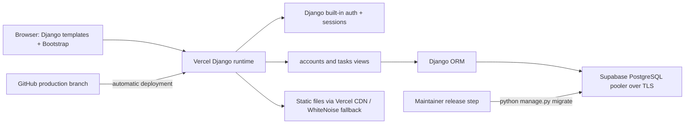

# TaskFlow product and architecture

## Product brief

**Purpose:** Help an individual keep daily work, priorities, and deadlines in one private, low-friction workspace.

**Primary audience:** Students, individual contributors, and hackathon users who need a clear personal task list without team administration overhead.

**Value proposition:** TaskFlow turns a scattered to-do list into a simple loop: capture a task, see what is due, make progress, and close it out.

### Outcomes and success measures

- A new user can register and create their first task without assistance.
- Returning users can quickly see pending, in-progress, completed, and overdue work.
- Every task query and mutation is limited to the authenticated owner.
- Core flows work on narrow mobile screens as well as desktop.
- Production stores data in Supabase PostgreSQL and can be redeployed without losing it.

### Scope

**Included:** Registration, login, POST logout, profile edit, password change, personal dashboard, task CRUD, status completion, title search, priority/status filters, due-date/newest sorting, overdue logic, Django admin, Supabase PostgreSQL, Vercel deployment, static assets, and automated Django tests.

**Explicitly excluded:** Team workspaces, task sharing, notifications, recurring tasks, file attachments, public APIs, React/Next.js, Supabase client-side auth, background workers, and AI. These add product or infrastructure complexity without being necessary for a single-user task manager.

### Core user journeys

1. **First visit:** Landing page → register with username/email/password → authenticated dashboard → create task.
2. **Daily planning:** Dashboard counts and upcoming items → task list → search/filter/sort → task details.
3. **Task completion:** Task details → mark complete (POST) → updated status and dashboard counts.
4. **Account maintenance:** Profile → edit username/email, or change password via Django's built-in view.
5. **Destructive action:** Task details → delete confirmation → POST deletion → task list.

### Functional requirements and acceptance checks

| Area | Behavior | Acceptance check |
|---|---|---|
| Accounts | Django password hashing, registration and login | Valid registration logs in; invalid or duplicate values show form errors |
| Authorization | All task reads and writes use the current user | Another account receives 404 for the task detail/edit/delete URL |
| Dashboard | Owner-only counts and five soonest open future tasks | Counts change after create/complete/delete; other owners' rows do not affect them |
| CRUD | Create, view, edit, complete, delete | Changes persist after reload; delete requires POST after confirmation |
| Find tasks | Case-insensitive title query, priority/status filters, due/newest order | Combined query parameters constrain the same owner-only queryset |
| Deadlines | Earlier than local date and not completed means overdue | Past due open item is overdue; completed past item is not |
| Profile | View/update username and email, change password | Server-side validation runs and current password is required for password change |
| Deployment | Vercel app + Supabase database | Production registration and CRUD pass with migrations applied |

## Technical architecture

### Runtime and responsibilities

- `config/`: environment parsing, security settings, middleware, URL roots, WSGI/ASGI entrypoints.
- `accounts/`: Django `User` form flows, profile form and account routes.
- `tasks/`: Task schema, model form, owner-scoped task views, dashboard aggregation, admin, migrations, tests.
- `templates/`: server-rendered pages; forms submit through Django with CSRF tokens.
- `static/`: local design-system CSS and favicon; Vercel publishes collected assets through its CDN.
- Supabase is PostgreSQL only. There is no browser-to-Supabase access and no anon/service-role key in Django settings.

### Data model

`Task` uses Django's `BigAutoField` primary key; owner is a cascading foreign key to `AUTH_USER_MODEL`. Title length is 200, description is optional, priority is Low/Medium/High, status is Pending/In Progress/Completed, and due date is a date. Created/updated timestamps are timezone-aware datetimes. Default ordering is due date, then newest first. Composite indexes support owner/status and owner/due-date lookups. Django's built-in migrations own all auth/session tables.

### Route and form contract

This is a server-rendered web application, not a JSON API. Forms use Django CSRF middleware and return HTML or redirects. State changes use POST.

| Method | Route | Access | Purpose |
|---|---|---|---|
| GET | `/` | Public | Landing page; authenticated users go to dashboard |
| GET, POST | `/accounts/register/` | Anonymous | Validate/create user and sign them in |
| GET, POST | `/accounts/login/` | Anonymous | Django login view |
| POST | `/accounts/logout/` | Authenticated | End the session |
| GET | `/dashboard/` | Authenticated | Owner-only summary and upcoming tasks |
| GET | `/tasks/` | Authenticated | Owner-only list; `q`, `priority`, `status`, `sort` filters |
| GET, POST | `/tasks/new/` | Authenticated | Create a task owned by the current user |
| GET | `/tasks/<id>/` | Authenticated | Task detail |
| GET, POST | `/tasks/<id>/edit/` | Authenticated | Update task |
| GET, POST | `/tasks/<id>/delete/` | Authenticated | Confirm then delete via POST |
| POST | `/tasks/<id>/complete/` | Authenticated | Mark complete |
| GET, POST | `/accounts/profile/` | Authenticated | View and update profile |
| GET, POST | `/accounts/password-change/` | Authenticated | Django password change form |
| GET | `/admin/` | Staff | Django administration |

### Security and data lifecycle

- `SECRET_KEY`, `DATABASE_URL`, `DEBUG`, hosts, and CSRF origins come from environment settings.
- Production runs with `DEBUG=False`, secure cookies, HTTPS redirect, proxy HTTPS awareness, CSRF middleware, and host validation.
- Task views begin with `Task.objects.filter(user=request.user)` or retrieve with both primary key and owner.
- Password handling is delegated to Django auth forms and validators.
- Database changes are applied as an explicit release step; migrations are not run from the request path.
- Supabase backups/retention should be configured in the project owner's Supabase settings and periodically restored to a staging project as a recovery exercise.

## Assumptions and decisions to revisit

- This release is a single-user workspace. Shared ownership and organization roles are out of scope.
- The app uses `Asia/Kolkata` as its configured timezone; per-user timezone selection is not implemented.
- Email is collected and validated but email verification and password reset email delivery are not configured. Add them before relying on email as a verified identity or recovery channel.
- Account deletion and data export are not provided in this MVP.
- Task title/email uniqueness is not globally required beyond the implemented account email validation.
- Bootstrap and Google Fonts are loaded from public CDNs. If offline support, strict CSP, or asset residency becomes a requirement, vendor the fonts/framework assets locally.

## Milestones

| Milestone | Deliverable | Completion signal |
|---|---|---|
| Discovery | This product scope, route map, architecture and open decisions | Scope reviewed against task brief |
| Design | Shared tokens, responsive page layouts, interaction and accessibility rules | All key templates use the same visual language |
| Core engineering | Auth, owner-scoped task flows, dashboard, filters, migration | Automated Django suite passes |
| Integration | Supabase URL, Vercel environment and static setup | Production function connects and schema is current |
| Release | Controlled migration and smoke-check | Register, CRUD and owner isolation verified live |
| Operations | Logs, backups, dependency updates and recovery procedure | Named maintainer follows the runbook |
